# MajuTech — Full-Stack E-Commerce Platform (Jakarta EE)

> A complete multi-role e-commerce web application for gadgets and tech accessories, built with Jakarta EE 9.1 (Java 17), JSP/Servlets, EJB, JPA and Apache Derby — featuring a persistent shopping cart, campaign-driven promotions, an admin analytics dashboard, and an order-to-payment checkout pipeline.


---

## Table of Contents

- [Project Overview](#project-overview)
- [Features](#features)
- [Technology Stack](#technology-stack)
- [System Architecture](#system-architecture)
- [Database Design](#database-design)
- [Project Structure](#project-structure)
- [Authentication & Security](#authentication--security)
- [Screenshots](#screenshots)
- [Installation](#installation)
- [Demo Accounts](#demo-accounts)
- [Troubleshooting](#troubleshooting)
- [My Contributions](#my-contributions)
- [Challenges](#challenges)
- [Future Improvements](#future-improvements)
- [License](#license)

---

## Project Overview

**MajuTech** is a production-style e-commerce system that lets customers browse and buy technology products while giving store staff and managers a full administrative backend to manage inventory, process orders, run promotional campaigns, and monitor sales performance.

### The business problem it solves

Small and mid-sized tech retailers typically juggle a public catalog, manual order tracking, and spreadsheet-based reporting. MajuTech consolidates these into a single web application:

- **Customers** get a self-service storefront: product discovery, persistent carts, checkout with shipping and payment, order tracking, and product reviews.
- **Administrators and staff** get an operational dashboard: product & category management, order fulfillment, sales analytics, customer and staff administration, and time-boxed discount campaigns — all in one place.

### Target users

| Role | Description |
| --- | --- |
| **Customer** | Shoppers who register, browse, purchase, and review products. |
| **Staff** | Day-to-day operators who manage products, campaigns, orders, and reply to reviews. |
| **Manager** | Senior administrators with additional privileges — staff administration and sales reporting. |

### Overall workflow

A typical end-to-end customer journey (full-stack flow across frontend views, servlet controllers, service-layer business logic, and the database):

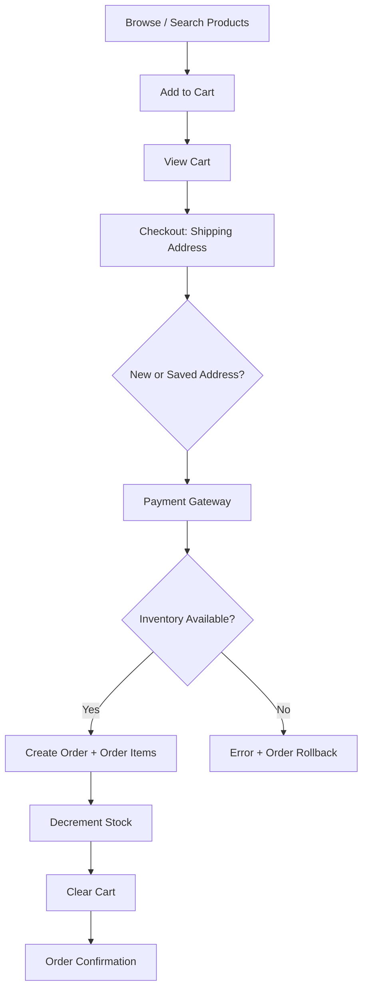

On the administration side, staff move orders through a lifecycle (`Processing → Shipped → Delivered`), create promotional campaigns that automatically activate/expire, and use the dashboard to review KPIs and sales trends.

---

## Features

Features are grouped by the three roles defined in the authorization model (`customer`, `staff`, `manager`).

### Customer

- **Account management** — register with username/email/phone, login, and logout. Duplicate usernames are rejected and password confirmation is validated.
- **Product catalog** — browse all products with **search by keyword**, **price-range filters**, and **multi-category filters** (`ShopServlet`).
- **Product detail pages** — up to four product images, specifications, description, average rating, and a per-product review list with admin replies.
- **Persistent shopping cart** — cart and line items are stored in the database per user (not in-memory), so the cart survives across sessions and logins (`CartService.getOrCreateCart`).
- **Checkout flow** — select a saved shipping address or add a new one, then pay through a simulated payment gateway supporting credit-card and other payment tabs. Shipping is **free on orders above RM 1,000** and costs **RM 10 otherwise** (business rule in `ProcessPaymentServlet.countTotalAmount`).
- **Order management** — view order history and order details; a full **order confirmation** page is shown after purchase.
- **Product reviews & ratings** — verified customers can rate and review purchased products (enforced by a unique `(order_id, product_id)` constraint so one review per purchased item).
- **SMS OTP** — 4-digit one-time password delivered via the 360.my bulk SMS gateway during OTP-enabled actions.
- **Promotions** — sees active campaign countdowns and discounted ("promotion") prices automatically applied at the storefront.

### Administrator / Staff

- **Admin dashboard** — KPI cards (total orders, total sales, units sold, total discount), order-status breakdown, a **7-day weekly-sales bar chart** (Chart.js), a **product-share pie chart**, **top-10 selling products**, and recent transactions.
- **Product management (CRUD)** — add, edit, list, and delete products; multi-image upload (up to 4 images) streamed to the **Cloudinary** CDN and stored as secure URLs.
- **Category management** — categories drive the storefront filter and product grouping.
- **Order management** — view all orders and **update order status asynchronously** (AJAX → JSON endpoint in `UpdateStatusServlet`).
- **Campaign / promotion management** — create, edit, and delete time-boxed percentage-discount campaigns with **overlap detection**; campaigns auto-activate and auto-expire based on date windows (`CampaignService.checkOngoingCampaign`).
- **Sales reporting** — current-vs-previous-month comparison, daily (last 7 days) and monthly reports, plus exportable sales detail views (HTML/PDF-style pages).
- **Review moderation** — browse all customer reviews and **reply to each review** (visible back on the product page).
- **Staff administration (Manager only)** — add and delete staff accounts (`/admin/staff` guarded by role).
- **Customer administration** — view and delete customer accounts.
- **Admin profile** — view/manage the logged-in admin's profile.
- **Graceful error handling** — dedicated error pages for HTTP 400/401/403/404/500/503.

---

## Technology Stack

| Layer | Technology |
| --- | --- |
| **Programming Language** | Java 17 (`javac.source` / `javac.target = 17`) |
| **Framework** | Jakarta EE 9.1 — Web Profile (`j2ee.platform = 9.1-web`): Servlet 5.0, JSP, JSTL, CDI, EJB, JPA 3.0, JTA |
| **Architecture Pattern** | Model-View-Controller (MVC) with Servlets as controllers, EJB session beans as services, JSP as views |
| **Persistence** | Jakarta Persistence (JPA 3.0) with the GlassFish/EclipseLink provider; `EntityManager` + JPQL |
| **Database** | Apache Derby (Java DB) — network server on `localhost:1527`, database `majutechdb` |
| **Application Server** | GlassFish 6.2.5 (must run on JDK 17) |
| **IDE** | Apache NetBeans (project metadata in `nbproject/`) |
| **Build Tools** | Apache Ant (`build.xml`, NetBeans-generated) |
| **Libraries** | Cloudinary 1.34.0 (image CDN), Apache HttpClient 4.5.14 / HttpCore 4.4.13 / HttpMime 4.5, Apache Commons IO 2.11.0 / Codec 1.15 / Logging 1.2, JSON (20211205) |
| **Frontend** | JSP + custom CSS, Chart.js, Bootstrap Icons, Font Awesome (CDN), vanilla JavaScript |
| **Transactions** | JTA with container-managed (EJB) and bean-managed `UserTransaction` boundaries |

> **Note on the JPA provider:** `persistence.xml` contains a `hibernate.hbm2ddl.auto` property, but the project's annotation-processing configuration targets **EclipseLink** (the GlassFish default). The Hibernate property is a leftover and is not used.

---

## System Architecture

MajuTech follows a classic **layered MVC** architecture. There is no Spring or JSF — the application is built purely on the Jakarta EE Web Profile: **Servlets (controllers) → EJB Stateless Session Beans (business logic) → JPA Entities (models) → JSP (views)**.

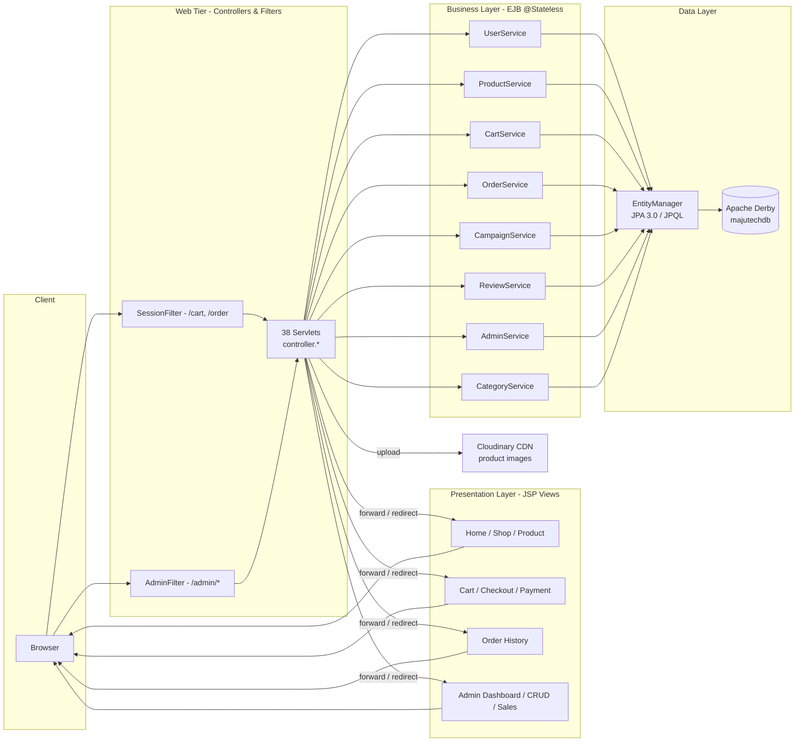

### MVC implementation

| Concern | Where it lives | Examples |
| --- | --- | --- |
| **Model** | `model/` — JPA entities mapped to relational tables | `User`, `Product`, `Order`, `CartItem`, `Campaign` |
| **View** | `web/view/*.jsp` — JSP pages rendered with JSTL/EL | `home.jsp`, `cart.jsp`, `payment-gateway.jsp`, `dashboard.jsp` |
| **Controller** | `controller/` — `HttpServlet` subclasses handling `doGet`/`doPost` | `ShopServlet`, `AddToCartServlet`, `ProcessPaymentServlet` |
| **Business logic** | `service/` — `@Stateless` EJB session beans using `EntityManager` | `OrderService`, `CartService`, `CampaignService` |

### Request lifecycle

1. A request hits a URL pattern mapped in `web.xml` (e.g., `/product`, `/cart`, `/admin/dashboard`).
2. A servlet **filter** runs first — `SessionFilter` guards `/cart` and `/order`; `AdminFilter` guards `/admin/*` and enforces role-based access.
3. The matching **servlet controller** reads parameters, invokes the injected **EJB service**, and sets request attributes.
4. The controller **forwards** to a **JSP view**, or redirects (e.g., after successful login/order).
5. The JSP renders HTML (often with EL + JSTL) and returns it to the browser.

### Key URL endpoints

URL patterns are declared in `web.xml` and resolved to servlet classes:

| URL pattern | Servlet | View / Action |
| --- | --- | --- |
| `/` · `/home` | `HomeServlet` | `home.jsp` — landing page + featured/promo products |
| `/product` · `/product/*` | `ShopServlet` | `products.jsp` / `product-details.jsp` — catalog, filters, reviews |
| `/register` · `/login` · `/logout` | `RegisterServlet` · `LoginServlet` · `LogoutServlet` | Customer auth |
| `/add-to-cart` · `/cart` · `/remove-from-cart/*` | `AddToCartServlet` · `ViewCartServlet` · `RemoveFromCartServlet` | Persistent cart |
| `/checkout/*` → `/process-address` → `/payment` → `/confirmation` | `CheckoutCartServlet` · `ProcessAddressServlet` · `ProcessPaymentServlet` · `OrderConfirmationServlet` | Checkout pipeline |
| `/order` · `/order/*` · `/review` | `ViewOrderServlet` · `ReviewServlet` | Order history + reviews |
| `/admin/login` · `/admin/dashboard` | `AdminLoginServlet` · `DashboardServlet` | Admin auth + KPIs/charts |
| `/admin/product` · `/admin/add-product` · `/admin/edit-product/*` · `/admin/delete-product` | `ProductListServlet` · `AddProductServlet` · `EditProductServlet` · `DeleteProductServlet` | Product CRUD + Cloudinary upload |
| `/admin/campaign` · `/admin/create-campaign` · `/admin/edit-campaign` · `/admin/delete-campaign` | `CampaignListServlet` · `CreateCampaignServlet` · `EditCampaignServlet` · `DeleteCampaignServlet` | Campaign management |
| `/admin/order` · `/admin/update-status` | `OrderListServlet` · `UpdateStatusServlet` | Order list + AJAX status updates |
| `/admin/sales` · `/admin/sales/details` | `SalesServlet` · `SalesDetailServlet` | Sales reports (manager-only) |
| `/admin/staff` · `/admin/add-staff` · `/admin/delete-staff` | `AdminListServlet` · `CreateAdminServlet` · `DeleteAdminServlet` | Staff management (manager-only) |
| `/admin/customer` · `/admin/delete-user` | `UserListServlet` · `DeleteUserServlet` | Customer management |
| `/admin/review` · `/admin/reply` | `ReviewListServlet` · `ReplyServlet` | Review moderation |
| `/request-otp` | `RequestOTPServlet` | SMS OTP delivery |

### Transaction strategy

- **Container-managed transactions (CMT):** every EJB `@Stateless` service method runs inside a container-managed JTA transaction — persistence operations (`persist`, `merge`, `remove`) commit atomically.
- **Bean-managed transactions (BMT):** servlets that orchestrate multi-step writes — registration (`RegisterServlet`), new shipping address (`ProcessAddressServlet`), product upload (`AddProductServlet`), and order-status updates (`UpdateStatusServlet`) — open explicit `UserTransaction.begin()/commit()` boundaries and roll back on failure.

### Controller → Business Logic → Database flow (checkout example)

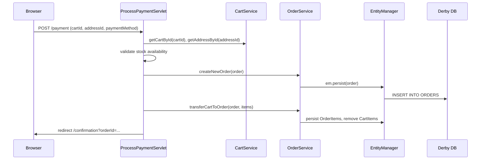

---

## Database Design

The schema is **auto-generated from JPA entities** (`persistence.xml` sets `jakarta.persistence.schema-generation.database.action = create`), so there are no SQL migration scripts in the repository — the 13 entities below are the source of truth for the schema.

### Entities (13 tables)

| Entity | Table | Key fields | Role |
| --- | --- | --- | --- |
| `User` | `USERS` | id, username, password, email, phone, gender | Customer accounts |
| `Admin` | `ADMINS` | id, username, password, role | Staff/manager accounts |
| `Product` | `PRODUCTS` | id, product_name, unit_price, category_id, specification, description, status, image1–4, quantity | Catalog items + inventory |
| `Category` | `CATEGORIES` | id, category_name | Product grouping |
| `Cart` | `CART` | cart_id, user_id | Per-user persistent cart |
| `CartItem` | `CART_ITEMS` | id, cart_id, product_id, quantity | Cart line items |
| `Order` | `ORDERS` | order_id, user_id, total_amount, payment_method, address_id, status, date | Customer orders |
| `OrderItem` | `ORDER_ITEMS` | id, order_id, product_id, quantity, current_price | Order line items (price snapshot) |
| `ShippingAddress` | `SHIPPING_ADDRESS` | id, user_id, name, street1/2, state, postcode, phone_number | Delivery addresses |
| `Campaign` | `CAMPAIGN` | id, campaign_name, date_start, date_end, discount_percentage, status | Promotional windows |
| `CampaignItem` | `CAMPAIGN_ITEM` | id, campaign_id, product_id, discounted_price | Discounted products per campaign |
| `Review` | `REVIEWS` | id, order_id, product_id, username, rating, comment, reply_id | Product reviews (unique per order+product) |
| `Reply` | `REPLIES` | id, review_id, username, comment | Admin replies to reviews |

### Relationships (ERD)

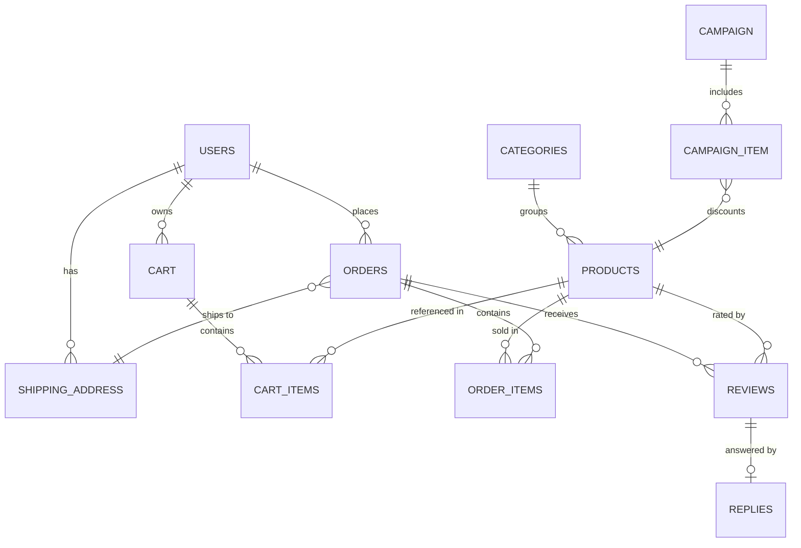

**Design observations**

- **Strong JPA relationships** (`@ManyToOne`/`@OneToOne` with `@JoinColumn`) model: `User→Order→ShippingAddress`, `Order→OrderItem→Product`, `Cart→CartItem→Product`, `Review→Order/Product`, and the one-to-one `Review→Reply`.
- **Soft foreign keys** — `Product.category_id` and `CampaignItem.campaign_id`/`product_id` are plain integer columns rather than mapped relationships. This is functional but means referential integrity is enforced in application code rather than by JPA.
- **Price snapshots** — `OrderItem.current_price` records the price at purchase time, so historical orders stay accurate even if product or campaign prices change.
- **Review integrity** — a unique constraint on `(order_id, product_id)` guarantees a customer can review a purchased item only once.
- **Campaign pricing** — products flagged `status = "promotion"` get their displayed price (`effectivePrice`, a `@Transient` field) from the matching `CampaignItem.discounted_price`.

---

## Project Structure

```
MajuTech/
├── build.xml                    # Apache Ant build script (NetBeans-generated)
├── nbproject/                   # NetBeans project metadata & Ant integration
├── setup/                       # Resource folder (empty)
├── test/                        # Test sources (empty)
├── src/
│   ├── conf/                    # Deployment descriptors (MANIFEST.MF)
│   └── java/
│       ├── controller/          # 38 Servlets — request handling & flow control
│       ├── model/               # 13 JPA entities — data model
│       ├── service/             # 8 EJB @Stateless beans — business logic & persistence
│       ├── utils/               # Filters + helpers (AdminFilter, SessionFilter,
│       │                        #   CloudinaryConfig, SSLUtil)
│       └── META-INF/
│           └── persistence.xml  # JPA persistence unit (MajuTechPU)
└── web/
    ├── index.html               # Static entry stub
    ├── css/                     # Page styles (style.css, cart, payment-gateway, ...)
    ├── script/                  # Client-side JS (script.js, clientscript.js, sidebarmenu.js)
    ├── image/                   # Static images (banners, features, people, pay)
    ├── view/                    # ~40 JSP views (home, cart, dashboard, sales, ...)
    └── WEB-INF/
        ├── web.xml              # Servlet declarations, URL mappings, error pages
        ├── glassfish-web.xml    # GlassFish web descriptor
        ├── glassfish-resources.xml  # Derby JDBC resource & connection pool
        └── lib/                 # Bundled jars (Cloudinary, HttpClient, Commons, JSON)
```

### What each folder does

| Path | Purpose |
| --- | --- |
| `src/java/controller/` | **Presentation logic** — each servlet maps to a URL (declared in `web.xml`) and coordinates a request: parse input → call a service → forward/redirect to a JSP. |
| `src/java/service/` | **Business layer** — stateless EJB beans (`@Stateless`) that encapsulate rules: cart persistence, order creation + rollback, campaign auto-lifecycle, review uniqueness, top-10 product aggregation. |
| `src/java/model/` | **Domain model** — JPA entities with field mapping and relationship annotations; the schema is generated from these classes. |
| `src/java/utils/` | **Cross-cutting concerns** — servlet filters for authentication/authorization, Cloudinary client factory, and an SSL helper. |
| `web/view/` | **Views** — JSP pages; the admin pages (`dashboard.jsp`, `sales.jsp`, `order-list.jsp`, ...) reuse `admin-header.jsp` / `sidebar.jsp` fragments, and the client pages reuse `client-navbar.jsp` / `client-footer.jsp`. |
| `web/WEB-INF/lib/` | **Bundled runtime dependencies** (not provided by GlassFish). |
| `web/WEB-INF/glassfish-resources.xml` | **JDBC resource** `jdbc/majutechdb` backed by a Derby connection pool (`majutechconn`). |

---

## Authentication & Security

> ⚠️ **Important:** This project is an academic/portfolio implementation. It demonstrates the **correct architectural patterns** for auth (filters, session scoping, role-based access) but uses **outdated credential practices** that must be hardened before any production use. See [Future Improvements](#future-improvements).

### Authentication mechanism

- **Form-based login** for both customers (`/login`) and admins (`/admin/login`). Credentials are looked up by username via `UserService` / `AdminService` and compared directly against the stored value.
- **Password hashing: none.** Passwords are stored and compared **in plain text** (`user.getPassword().equals(password)`). This is a known limitation — a hashing scheme such as BCrypt (or at least PBKDF2/salted SHA-256) should replace it.

### Session management

- After a successful login the user/admin object is placed in the **HTTP session**: session attributes `user`, `admin`, and (for admins) `adminRole`.
- `SessionFilter` guards `/cart` and `/order`, redirecting unauthenticated visitors to `/login`.
- `AdminFilter` guards the whole `/admin/*` tree, redirecting unauthenticated visitors to `/admin/login` and forwarding staff to the **403 error page** when they try to reach manager-only sections.
- Logout invalidates the session through `LogoutServlet` / `AdminLogoutServlet`.

### Authorization model (RBAC)

| Role | Permitted areas |
| --- | --- |
| `customer` (public) | Storefront, cart, checkout, orders, reviews |
| `staff` | `/admin/*` except `/admin/staff` and `/admin/sales` |
| `manager` | All admin areas, including staff administration and sales reports |

Role checks are enforced centrally in `AdminFilter` (a form of role-based access control / RBAC) and the UI conditionally hides manager-only menu items.

### Other security notes

- **Cloudinary API credentials are hard-coded** in `CloudinaryConfig.java` (cloud name, API key, API secret) and **SMS gateway credentials are hard-coded** in `RequestOTPServlet.java`. These should be externalized to environment variables / server configuration.
- `SSLUtil.disableSslVerification()` disables TLS certificate validation so the app can call the SMS gateway over a self-signed setup. This is **development-only** and must never run in production.
- Client-side validation is complemented by server-side checks in several places (password confirmation, duplicate usernames, stock availability, campaign date overlap), though a full input-validation/interceptor layer is not present.
- No CSRF tokens, rate-limiting, or output-encoding hardening were observed — additional items for production hardening.

---

## Screenshots

> Placeholders — replace each file under `docs/images/` with a real capture.

### Customer pages

| Page | Screenshot |
| --- | --- |
| Home / Landing |  |
| Product Listing (Shop) | 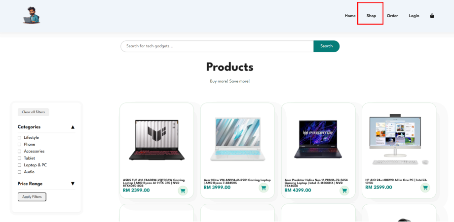 |
| Product Details & Reviews | 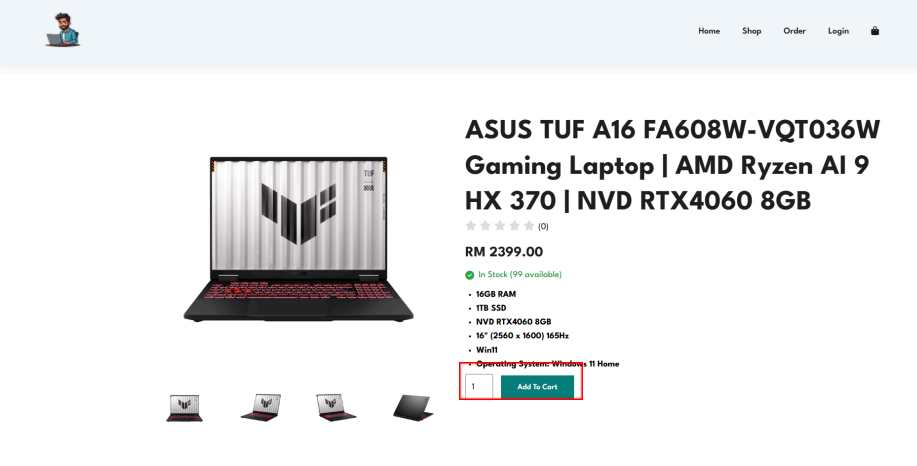 |
| Login / Register |  |
| Cart | 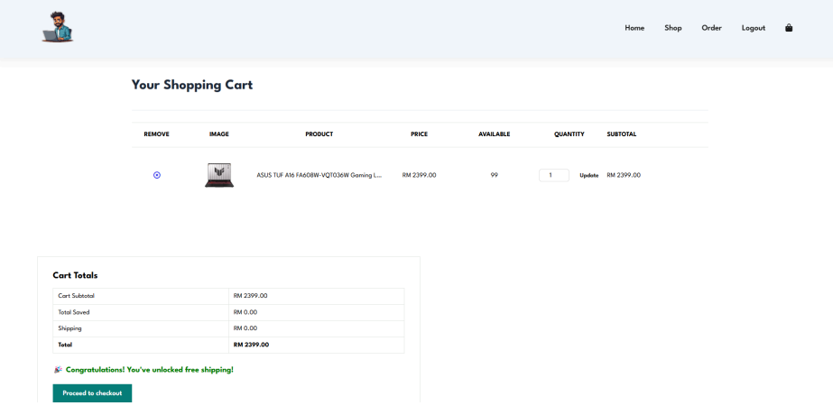 |
| Shipping Address | 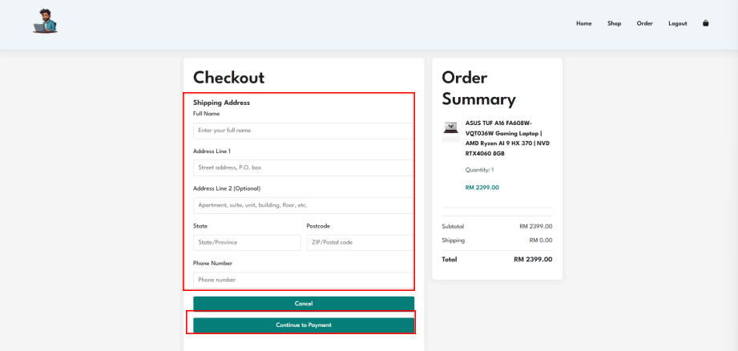 |
| Payment Gateway | 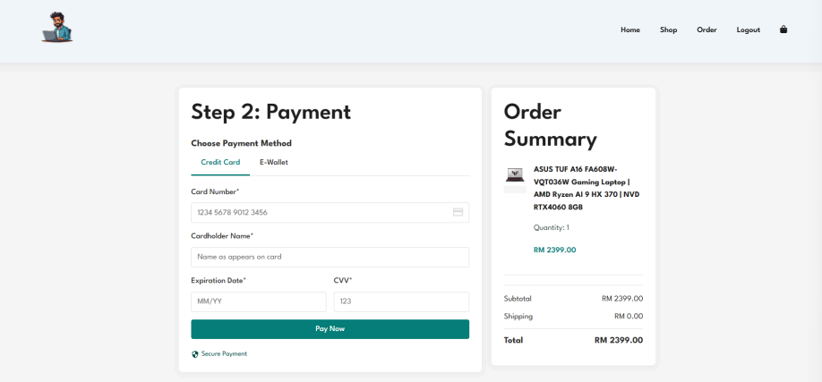 |
| Order Confirmation | 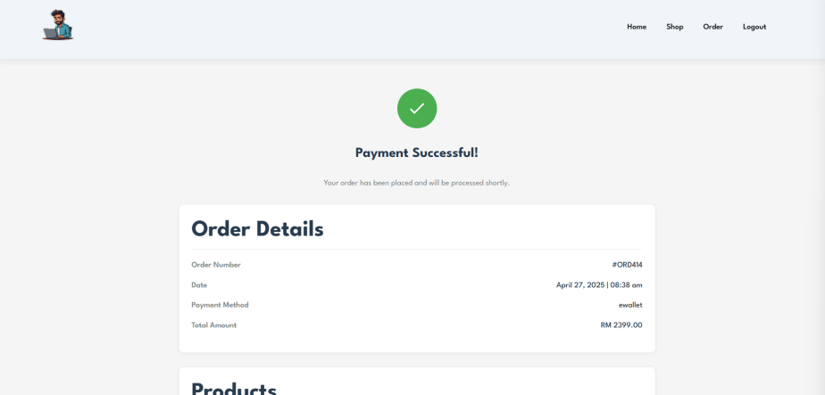 |
| Order History | 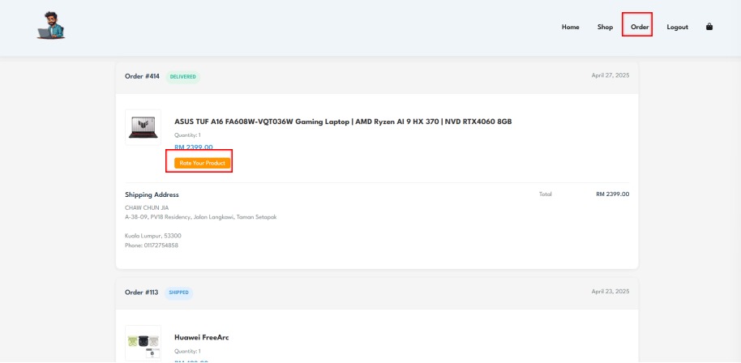 |

### Admin pages

| Page | Screenshot |
| --- | --- |
| Admin Login | 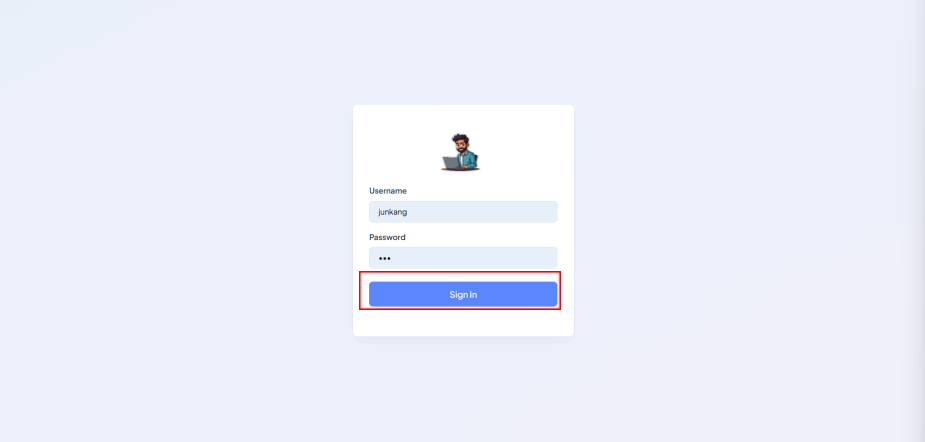 |
| Dashboard (KPIs & charts) | 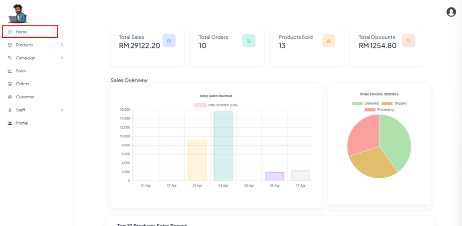 |
| Product List / Add / Edit | 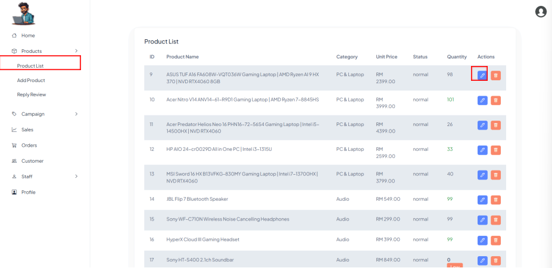 |
| Campaign Management | 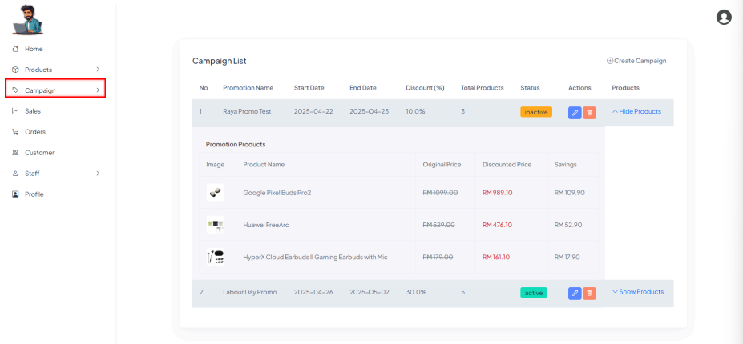 |
| Order List & Status | 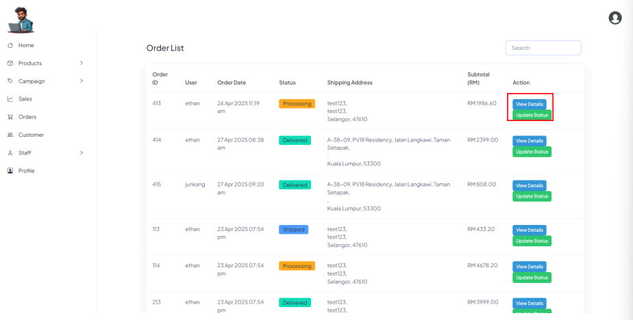 |
| Sales Reports | 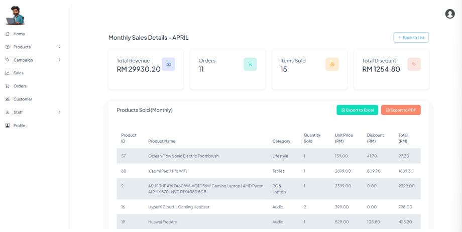 |
| Review Moderation | 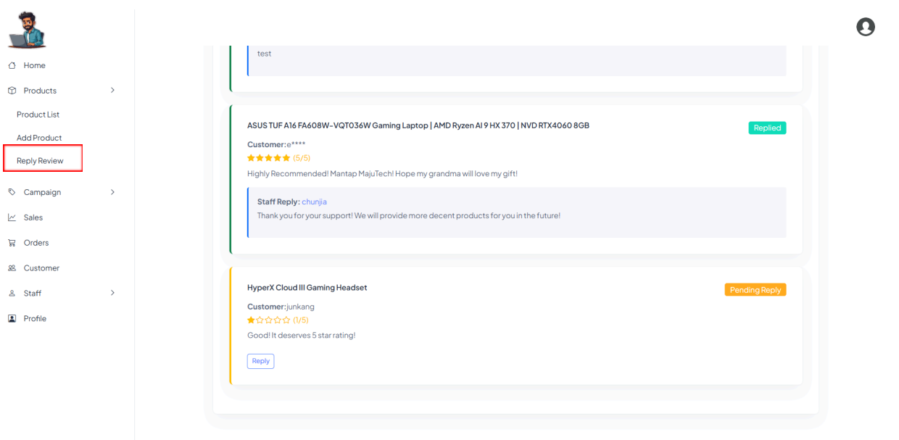 |
| Staff Management | 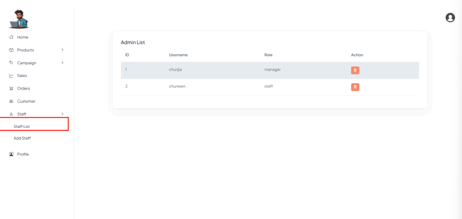 |
| Customer Management | 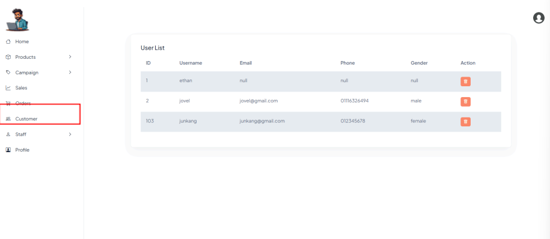 |

---

## Installation

### Prerequisites

| Requirement | Version | Notes |
| --- | --- | --- |
| JDK | **17** | Mandatory — GlassFish 6.2.5 runs only on JDK 17. Download from [Oracle JDK 17 archive](https://www.oracle.com/java/technologies/javase/jdk17-archive-downloads.html) (or a compatible OpenJDK 17). |
| GlassFish | **6.2.5** | The only server this project targets (`j2ee.server.type=gfv610ee9`). |
| Jakarta EE platform | **9.1 (Web)** | Auto-selected when you deploy to GlassFish 6.2.5. |
| Apache NetBeans | 17+ (any recent) | Recommended — project ships with `nbproject/` metadata. |
| Apache Derby (Java DB) | Bundled with GlassFish | Network server on port 1527; database `majutechdb`. |

> ⚠️ **Version compatibility is critical.** GlassFish 6.2.5 requires **JDK 17**; older JDKs will fail to start the server, and newer Jakarta EE target versions are not supported by this GlassFish release.

### Step-by-step setup

1. **Install the JDK 17** and set it as the active platform in NetBeans (`Tools → Java Platforms → Add Platform`).

2. **Install GlassFish 6.2.5** in NetBeans:
   - Open NetBeans → `Services → Servers → Add Server` → select **GlassFish Server → 6.2.5** and point it at your JDK 17 platform.
   - If an existing GlassFish install is broken, remove the server, close NetBeans, delete the folder under `C:\Users\<Username>\GlassFish`, then reopen NetBeans and use the project's **"Resolve Missing Server Problem"** action (above *Properties*) to reinstall GlassFish 6.2.5 and select it as the project server.

3. **Clean the NetBeans private state** (fixes stale-deploy errors):
   - Locate `nbproject/private` inside the project folder and **inspect its contents first** (it holds local user preferences only), then delete it so NetBeans regenerates a clean configuration.

4. **Verify the JDBC resource** (`web/WEB-INF/glassfish-resources.xml`):
   - It declares the JDBC resource `jdbc/majutechdb` and the connection pool `majutechconn` pointing at `jdbc:derby://localhost:1527/majutechdb` (user `master` / password `123456`).
   - Make sure the Derby server is running on port 1527 (`asadmin start-database`).

5. **Database import**:
   - No SQL script is required. The schema is **auto-created by JPA** (`schema-generation.database.action = create`) on first deploy, so the `majutechdb` tables are generated from the 13 entity classes automatically.

6. **Run the project**:
   - In NetBeans: right-click **MajuTech** → **Clean and Build**, then **Run** (deploys to GlassFish and opens the browser).
   - The application is served at `http://localhost:8080/MajuTech` (context root `/MajuTech`).

> **Deploy failed / module not deployed?** See [Troubleshooting](#troubleshooting).

---

## Demo Accounts

Development credentials referenced in the original `README.txt` (the database schema is auto-generated and contains no seed script, so on a fresh database these accounts must be re-created via the registration / add-staff flows):

| Role | Username | Password |
| --- | --- | --- |
| Customer | `ethan` / `jovel` | `123` |
| Administrator (Manager) | `manager` | `majutech123` |
| Staff | `staff1` | `123456` |

---

## Troubleshooting

Common issues and fixes distilled from the project's original `README.txt`:

**"Deployment Error" in NetBeans**
1. Inspect then delete the `nbproject/private` folder so NetBeans regenerates clean metadata.
2. Confirm the stack is JDK 17 + GlassFish 6.2.5 + Jakarta EE Web 9.1 (these are tightly coupled).
3. If the server registration is corrupted, remove GlassFish from NetBeans, close the IDE, delete `C:\Users\<Username>\GlassFish`, reopen NetBeans and use **"Resolve Missing Server Problem"** to reinstall GlassFish 6.2.5.

**"The module has not been deployed"**
1. Verify the contents of `glassfish-resources.xml` (JNDI name, pool name, Derby URL).
2. Replace older `derby.jar` / `derbyclient.jar` files in `glassfish/domains/domain1/lib/ext/` with versions matching the GlassFish release.
3. Restart GlassFish, then **Clean and Build** the project before redeploying.

---

## My Contributions

*This section is inferred from the repository structure and code (no Git history is available in the workspace). As the primary contributor and backend developer, responsibilities most likely included:*

- **Backend development** — authoring the 38 servlet controllers and the layered `controller → service → model` flow that makes up the entire request pipeline.
- **Database implementation & persistence layer** — designing the 13-entity JPA data model (users, admins, products, carts, orders, campaigns, reviews) with relationships, and configuring the Derby data source, connection pool, and JPA auto-schema-generation.
- **Business logic** — implementing the persistent cart, order/inventory transaction with rollback, campaign auto-activation/expiry engine, dynamic discount pricing, and sales aggregation queries (top-10 products, daily/monthly reports).
- **Authentication & authorization** — building the session-based login for customers and admins, and the filter-based RBAC (`AdminFilter`, `SessionFilter`) with manager/staff role separation.
- **Module development** — end-to-end feature modules: product CRUD with Cloudinary image upload, checkout & payment gateway, order management, reviews & replies, and the analytics dashboard with Chart.js visualizations.

---

## Challenges

- **MVC architecture at scale** — keeping a clean separation of concerns across ~40 servlets, 8 services, and 13 entities while avoiding business logic leaking into JSPs or controllers.
- **Persistent shopping cart** — designing a DB-backed cart (`Cart`/`CartItem`) that survives sessions and merges line-item quantities, instead of the typical in-memory cart.
- **Transactional checkout & inventory** — coordinating order creation, order-item transfer, stock decrement, and cart clearing under a single transaction, with **validation and rollback** when inventory is insufficient.
- **Session & role management** — centralizing authentication checks and manager-only restrictions through servlet filters and clean 403 handling.
- **Campaign lifecycle & pricing** — implementing date-window overlap detection, automatic activation/expiry, and a dynamic `effectivePrice` that applies campaign discounts without persisting stale values.
- **Relational integrity & reporting** — JPQL aggregation queries for top sellers and time-series sales reports against a normalized schema.
- **Team collaboration & environment setup** — resolving the JDK 17 / GlassFish 6.2.5 / Jakarta EE 9.1 coupling and local deploy issues (documented in `README.txt`).

---

## Future Improvements

Realistic, high-impact upgrades for this codebase:

- **Security hardening (priority)**
  - Replace plain-text passwords with **BCrypt** (e.g., `jBCrypt`/`Spring Security Crypto`) hashing and salted verification.
  - Move to **JWT-based stateless authentication** for a future API tier, while keeping session auth for the JSP UI.
  - Add **CSRF tokens**, input validation (Bean Validation / Jakarta Validation), and output encoding.
  - Externalize Cloudinary, SMS gateway, and database credentials to environment variables or GlassFish admin resources; remove the dev-only `SSLUtil` certificate bypass.
- **RESTful API** — expose the business layer as REST endpoints (Jakarta REST / JAX-RS) so a mobile app or separate SPA frontend can consume it.
- **Modern framework migration** — refactor toward **Spring Boot** (or keep Jakarta EE but adopt JSF/PrimeFaces or Vaadin) to reduce boilerplate and improve testability; the existing service layer maps cleanly to Spring services.
- **Pagination & performance** — add pagination to product/order/review listings and introduce caching for catalog reads.
- **Testing** — add unit tests (JUnit) for services and integration tests for the checkout/campaign flows; the `test/` folder is currently empty.
- **Docker & CI/CD** — containerize GlassFish + Derby with `docker-compose`, and add a CI pipeline (GitHub Actions / GitLab CI) that builds with Ant, runs tests, and deploys.
- **Cloud deployment** — deploy to a cloud Jakarta EE platform (e.g., AWS Elastic Beanstalk, Azure App Service, or a container registry + Kubernetes).
- **Responsive frontend** — upgrade the hand-written CSS to a component framework (Bootstrap 5 / Tailwind) for consistent mobile-first responsiveness, and add proper client-side validation.
- **Full-text search & richer catalog** — integrate search (e.g., Lucene/Elasticsearch) and product variants, and add a public REST product feed.

---

## License

Distributed under the MIT License. See `LICENSE` for more information.

```
MIT License

Copyright (c) 2026 MajuTech

Permission is hereby granted, free of charge, to any person obtaining a copy
of this software and associated documentation files (the "Software"), to deal
in the Software without restriction, including without limitation the rights
to use, copy, modify, merge, publish, distribute, sublicense, and/or sell
copies of the Software, and to permit persons to whom the Software is
furnished to do so, subject to the following conditions:

The above copyright notice and this permission notice shall be included in all
copies or substantial portions of the Software.

THE SOFTWARE IS PROVIDED "AS IS", WITHOUT WARRANTY OF ANY KIND, EXPRESS OR
IMPLIED, INCLUDING BUT NOT LIMITED TO THE WARRANTIES OF MERCHANTABILITY,
FITNESS FOR A PARTICULAR PURPOSE AND NONINFRINGEMENT. IN NO EVENT SHALL THE
AUTHORS OR COPYRIGHT HOLDERS BE LIABLE FOR ANY CLAIM, DAMAGES OR OTHER
LIABILITY, WHETHER IN AN ACTION OF CONTRACT, TORT OR OTHERWISE, ARISING FROM,
OUT OF OR IN CONNECTION WITH THE SOFTWARE OR THE USE OR OTHER DEALINGS IN THE
SOFTWARE.
```
